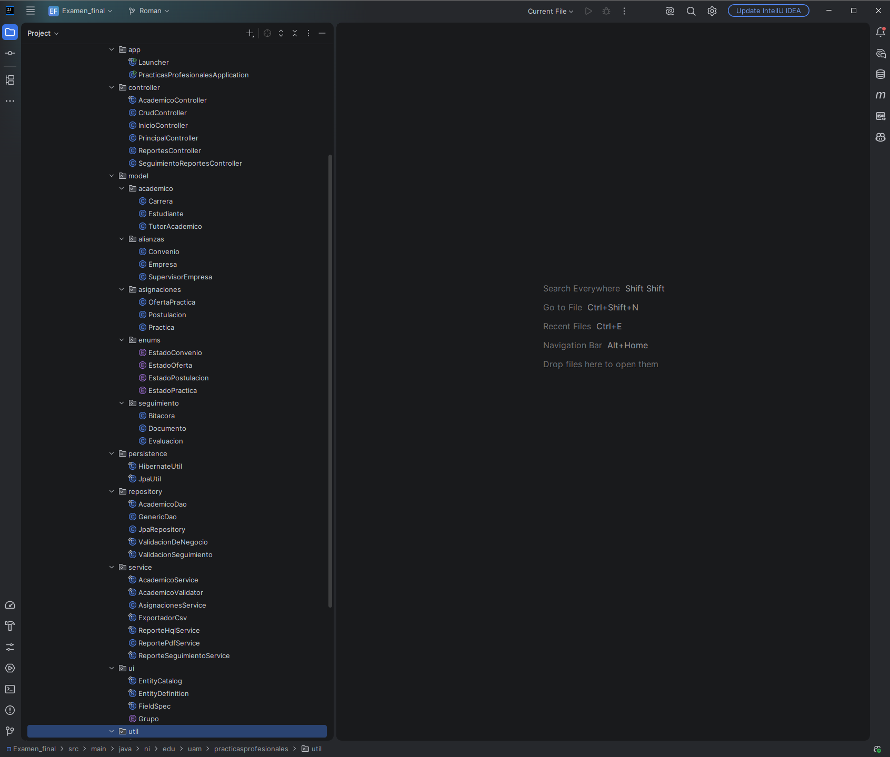
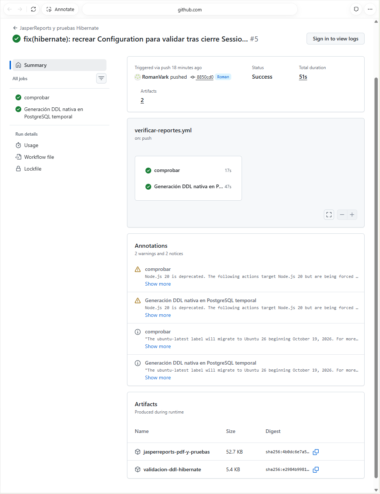
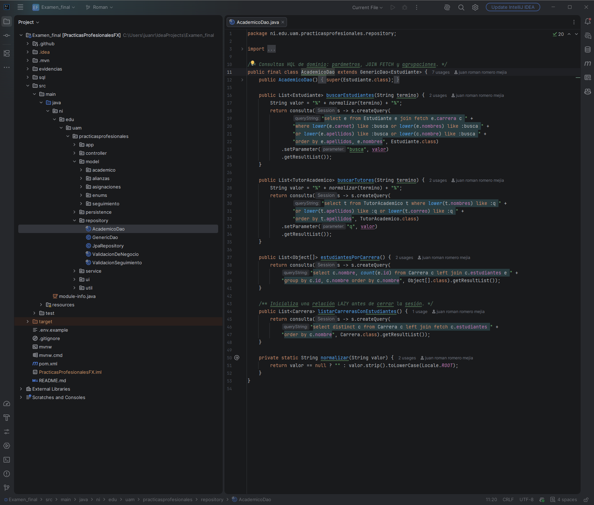
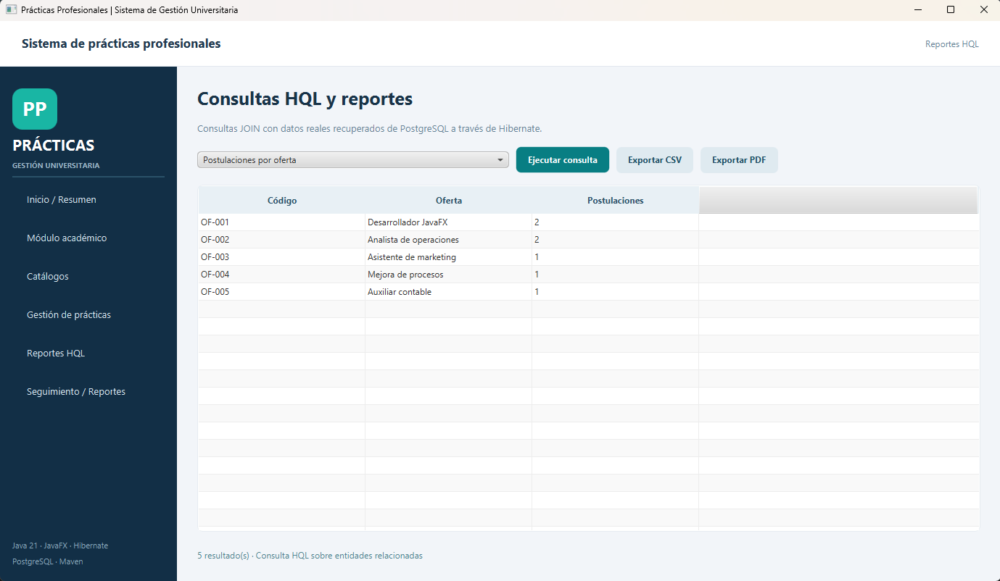
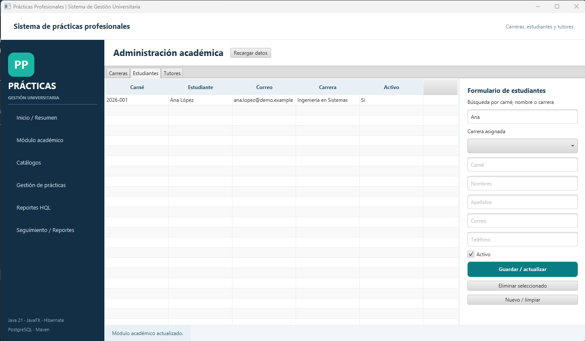
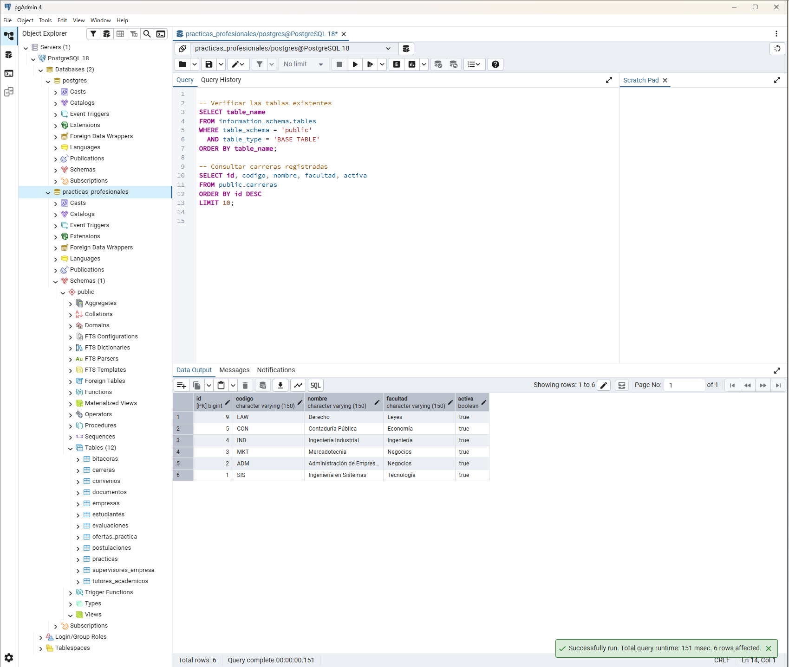

# Gestión de Prácticas Profesionales — JavaFX, Hibernate y JasperReports

## 1. Descripción del proyecto e integrantes

Aplicación de escritorio para administrar carreras, estudiantes, tutores, empresas, convenios, ofertas, postulaciones, prácticas y seguimiento. La interfaz **JavaFX** accede a **PostgreSQL** mediante la API nativa de **Hibernate ORM** y produce consultas HQL, archivos CSV y reportes PDF con **JasperReports**.

**Integrantes** (sin roles asignados):

- Alfredo Montealegre
- Christopher Santana
- Celeste Carrasco
- Juan Romero

Repositorio: https://github.com/RomanVark/Examen_final. Rama de trabajo: [Roman](https://github.com/RomanVark/Examen_final/tree/Roman).

**Aclaración:** el parent de Spring Boot administra dependencias, pero esta aplicación **no implementa una API REST ni endpoints JSON**. El laboratorio Hibernate utiliza `SessionFactory`, `Session` y `Transaction` de forma directa.

## 2. Requisitos

| Componente | Versión o requisito |
|---|---|
| JDK | Java 21; Temurin recomendado |
| Maven | Maven Wrapper incluido; en Windows usar `mvnw.cmd` |
| Interfaz | JavaFX 21.0.6 |
| ORM | Hibernate 7.4.13.Final y Jakarta Persistence 3.2 |
| Plataforma de dependencias | Spring Boot 4.1.2 |
| Base de datos | PostgreSQL 15 o superior |
| Reportes PDF | JasperReports 6.21.3 |
| Herramientas opcionales | IntelliJ IDEA, pgAdmin 4 y Scene Builder |

La guía HTML usa Hibernate 6 en su ejemplo; esta implementación conserva Hibernate **7.4** según la versión acordada para el proyecto. Si el docente exige literalmente Hibernate 6, debe confirmarse su aceptación.

Las contraseñas se configuran como variables de entorno. `.env.example` es solo una plantilla, no debe contener datos reales.

## 3. Cómo ejecutar el proyecto

### 3.1 Descargar e instalar

~~~powershell
git clone https://github.com/RomanVark/Examen_final.git
cd Examen_final
git switch Roman
git pull origin Roman
~~~

Abre la carpeta con `pom.xml` desde IntelliJ y selecciona JDK 21. Recarga las dependencias Maven.

### 3.2 Preparar la base de datos

1. En pgAdmin, conectado a `postgres`, ejecuta `sql/00_crear_base.sql` **solo si no existe** la base `practicas_profesionales`.
2. En una instalación nueva, conectado a `practicas_profesionales`, ejecuta `sql/01_esquema.sql`, que incluye las doce entidades y la tabla intermedia `carrera_tutor`.
3. Si la instalación ya tenía tablas, ejecuta solamente `sql/04_carrera_tutores.sql`, que añade la relación N–M sin borrar registros.
4. Opcional: ejecuta `sql/02_datos_ejemplo.sql` y revisa `sql/03_consultas_verificacion.sql`.

La base principal usa `hibernate.hbm2ddl.auto=validate` para comprobar el esquema sin modificarlo.

### 3.3 Configurar variables y abrir JavaFX

En PowerShell:

~~~powershell
$env:DB_URL="jdbc:postgresql://localhost:5432/practicas_profesionales"
$env:DB_USER="postgres"
$env:DB_PASSWORD="TU_CONTRASEÑA_LOCAL"
$env:HIBERNATE_DDL_AUTO="validate"

.\mvnw.cmd clean test
.\mvnw.cmd javafx:run
~~~

Si usas el botón **Run** de IntelliJ, agrega las mismas variables en la configuración de ejecución. Desde JavaFX puedes usar **Inicio/Resumen**, **Módulo académico**, **Catálogos**, **Gestión de prácticas**, **Reportes HQL** y **Seguimiento/Reportes**.

### 3.4 Ejecutar y comprobar los cuatro PDF JasperReports

~~~powershell
.\mvnw.cmd "-Dtest=ReportePdfServiceTest" test
Get-ChildItem .\target\reportes-verificados\*.pdf
~~~

Los cuatro archivos esperados son: `reporte_practicas.pdf`, `reporte_horas.pdf`, `reporte_postulaciones.pdf` y `reporte_promedios.pdf`. Estas pruebas usan **datos ficticios** y verifican que cada plantilla se compila y genera un archivo PDF con cabecera y cierre correctos.

Para exportar un reporte con **datos reales**, entra en JavaFX a **Reportes HQL**, selecciona el tipo y pulsa **Exportar PDF**. La generación trabaja en segundo plano mediante `FxDb`.

También está configurado el workflow [JasperReports y pruebas Hibernate](https://github.com/RomanVark/Examen_final/actions/workflows/verificar-reportes.yml) para ejecutar Maven y publicar los archivos de prueba. Comprueba el resultado de la ejecución: un workflow creado no equivale a un workflow exitoso.

### 3.5 Demostrar la generación automática de tablas con Hibernate

Esta prueba se hace **únicamente en una base vacía e independiente**, nunca sobre `practicas_profesionales`.

En pgAdmin, conectado a la base administrativa `postgres`, crea:

~~~sql
CREATE DATABASE practicas_profesionales_hibernate_demo;
~~~

Después, desde PowerShell:

~~~powershell
$env:DB_USER="postgres"
$env:DB_PASSWORD="TU_CONTRASEÑA_LOCAL"
$env:SCHEMA_DEMO_DB_URL="jdbc:postgresql://localhost:5432/practicas_profesionales_hibernate_demo"
$env:HIBERNATE_SCHEMA_DEMO="true"

.\mvnw.cmd "-Dtest=HibernateGeneracionEsquemaTest" test

Remove-Item Env:\HIBERNATE_SCHEMA_DEMO
Remove-Item Env:\SCHEMA_DEMO_DB_URL
~~~

El test `HibernateGeneracionEsquemaTest` comprueba que la base tenga **cero tablas previas**, ejecuta `hbm2ddl.auto=create-only` (sin `DROP`), verifica las **12 tablas de entidades + carrera_tutor**, revisa sus dos claves foráneas y vuelve a inicializar Hibernate con `validate`. Debe utilizarse una base demo recién creada para cada ejecución de generación.

Conectado a `practicas_profesionales_hibernate_demo`, verifica:

~~~sql
SELECT table_name
FROM information_schema.tables
WHERE table_schema = 'public' AND table_type = 'BASE TABLE'
ORDER BY table_name;
~~~

La consola con instrucciones `create table` más el resultado exitoso servirán para la captura `02-ddl-hibernate.png`. No se debe afirmar que la creación se completó hasta ejecutar y comprobar el test.

### 3.6 Módulo de consumo REST / JSON (evaluación integradora)

La aplicación incluye **Servicios REST / JSON** en su menú JavaFX. Consulta la API pública [JSONPlaceholder](https://jsonplaceholder.typicode.com/), cuyos usuarios son **simulados** (no son alumnos ni datos de la universidad).

| Operación | Método/endpoint | Resultado |
|---|---|---|
| Listado | `GET https://jsonplaceholder.typicode.com/users` | Tabla con usuarios |
| Detalle | `GET https://jsonplaceholder.typicode.com/users/1` | Un usuario concreto |

`UsuariosRestClient` utiliza `HttpClient` y comprueba el código HTTP, el tiempo máximo de espera, la respuesta vacía y los errores de conexión. Gson interpreta el JSON: `id`, `name`, `username`, `email`, `address.city` pasan a los cinco campos de `UsuarioApi`. `ServiciosWebController` administra el formulario, las columnas y las validaciones; `FxDb` mantiene la interfaz reactiva.

**Demostración:** abre Servicios REST / JSON, pulsa **GET /users — Listar usuarios**, selecciona el ID 1 y usa **GET /users/{id} — Detalle**. Comprueba también ID 999 (respuesta vacía / HTTP 404), un ID negativo o no numérico y una consulta sin acceso a Internet. Estas operaciones no necesitan contraseña. Pruebas locales de JSON y HTTP real con un servidor temporal: `./mvnw -Dtest=UsuariosRestClientTest,UsuariosRestHttpTest test`. Para el proyecto integrador hay que demostrar peticiones HTTP reales en vivo, no solo pruebas unitarias.

### 3.7 Excel, etiquetas y vista previa

En **Reportes HQL**, selecciona un reporte y pulsa **Vista previa PDF**. Se abre un visor institucional de las **páginas reales generadas por JasperReports**, con controles **Anterior / Siguiente**, zoom del **60 % al 160 %**, **Guardar PDF** e **Imprimir**. La vista previa y la exportación usan las mismas plantillas `.jrxml` y el mismo mapeo de datos HQL; el visor procesa la generación y el renderizado en segundo plano mediante `FxDb`.

- **Exportar PDF:** JasperReports crea el PDF desde una plantilla `.jrxml` con cabecera institucional, tarjetas de indicadores calculados, fecha, filas alternadas y numeración de páginas. También guarda el archivo compilado `.jasper` en `target/reportes-compilados/`. El visor usa `JasperPrintManager.printPageToImage()` para mostrar las páginas reales y `JasperPrintManager.printReport()` para imprimir.
- **Exportar Excel:** Apache POI genera un libro `.xlsx` válido con título, fecha, encabezados, registros, filtros de columna y panel fijo.
- **Exportar CSV:** mantiene la exportación existente.
- **Formularios:** etiquetas visibles en el módulo académico, etiquetas dinámicas, asteriscos, texto accesible y ayuda contextual en los catálogos.

Pruebas: `.\mvnw.cmd "-Dtest=ReportePdfServiceTest,ReporteExcelServiceTest" test`. Incluyen generación de los cuatro PDF, imagen PNG de la página JasperPrint, documentos de varias páginas y estructura Excel. Las plantillas `.jrxml` están en `src/main/resources/reportes/`. Pueden abrirse y guardarse en **Jaspersoft Studio**. El repositorio no demuestra por sí solo el editor en el que fueron creadas; esa parte debe mostrarse en la defensa si se exige literalmente.

### 3.8 Seguimiento: PDF institucional y vista previa real

En **Seguimiento / Reportes**, elige **Horas registradas por práctica** o **Promedio de evaluación por estudiante**. Los botones **Vista previa PDF** y **Exportar PDF** utilizan las plantillas `reporte_seguimiento_horas.jrxml` y `reporte_seguimiento_promedios.jrxml`, con encabezado institucional, fecha de generación, total de registros, indicador calculado y pie de página.

La vista previa reutiliza el mismo `ReportePreviewController` que **Reportes HQL**, con zoom, navegación entre páginas, impresión y guardado del PDF ya renderizado. Excel y CSV permanecen disponibles. Los registros del PDF provienen directamente de PostgreSQL a través de HQL y la generación se realiza fuera del hilo JavaFX.

Prueba de las plantillas con datos ficticios: `.\\mvnw.cmd "-Dtest=ReportePdfServiceTest" test`. Comprueba los archivos `target/reportes-verificados/reporte_seguimiento_horas.pdf` y `target/reportes-verificados/reporte_seguimiento_promedios.pdf`.

## 4. Modelo de datos

Las 12 entidades JPA se registran en `src/main/resources/hibernate.cfg.xml`.

| Entidad (tabla) | Atributos representativos | Relaciones |
|---|---|---|
| Carrera (`carreras`) | codigo, nombre, facultad, activa | 1–N Estudiante; N–M TutorAcademico |
| Estudiante (`estudiantes`) | carnet, nombres, apellidos, correo, carrera_id | N–1 Carrera; 1–N Postulacion y Practica |
| TutorAcademico (`tutores_academicos`) | nombres, correo, especialidad, activo | N–M Carrera; referenciado por Practica |
| Empresa (`empresas`) | ruc, razon_social, sector, correo | 1–N SupervisorEmpresa, Convenio y OfertaPractica |
| SupervisorEmpresa (`supervisores_empresa`) | nombres, correo, cargo, empresa_id | N–1 Empresa; referenciado por Practica |
| Convenio (`convenios`) | codigo, empresa_id, fechas, estado | N–1 Empresa |
| OfertaPractica (`ofertas_practica`) | codigo, titulo, cupos, empresa_id, estado | N–1 Empresa; 1–N Postulacion y Practica |
| Postulacion (`postulaciones`) | estudiante_id, oferta_id, fecha, estado | N–1 Estudiante y OfertaPractica |
| Practica (`practicas`) | estudiante_id, oferta_id, tutor_academico_id, horas_requeridas, estado | N–1 Estudiante, OfertaPractica, tutor y supervisor; 1–N seguimiento |
| Bitacora (`bitacoras`) | practica_id, fecha, actividad, horas | N–1 Practica |
| Evaluacion (`evaluaciones`) | practica_id, fecha, calificacion | N–1 Practica |
| Documento (`documentos`) | practica_id, tipo, ruta_archivo, fecha_entrega | N–1 Practica |

La tabla adicional `carrera_tutor(carrera_id, tutor_id)` implementa la relación muchos-a-muchos; **no es una entidad Java independiente**.

## 5. Decisiones de diseño, relaciones y control de versiones

### Relaciones, carga y cascadas

- **Carrera–Estudiante (1–N bidireccional):** `Carrera.estudiantes` declara `@OneToMany(mappedBy="carrera")` y `Estudiante.carrera` usa `@ManyToOne` con `@JoinColumn`. Los métodos `agregarEstudiante` y `quitarEstudiante` sincronizan ambos lados; la relación obligatoria debe tener una carrera asignada antes de persistir.
- **Carrera–TutorAcademico (N–M bidireccional):** `@ManyToMany` y `@JoinTable` usan la tabla `carrera_tutor`. Los métodos `agregarTutor` y `quitarTutor` actualizan ambos lados.
- **Cascadas:** no usamos `CascadeType.REMOVE` sobre N–M porque quitar un tutor de una carrera no debe eliminarlo de la universidad. Los registros principales se modifican o eliminan explícitamente y las FK restringen eliminaciones que comprometan el historial. El `ON DELETE CASCADE` de `carrera_tutor` elimina solo vínculos de la tabla intermedia.
- **Carga:** las colecciones utilizan `LAZY` y los DAOs ejecutan `JOIN FETCH` cuando la interfaz necesita relaciones tras cerrar la sesión. Algunas referencias `ManyToOne` usan `EAGER` en el código existente; deberán revisarse si aparecen problemas de rendimiento. Los `toString()` evitan recorrer colecciones.

### DAOs y HQL

`HibernateUtil` mantiene un único `SessionFactory`. `GenericDao<T>` implementa CRUD con `Session` y `Transaction`, `commit`, `rollback` y cierre con `try-with-resources`. `AcademicoDao` implementa consultas con parámetros nombrados, `JOIN FETCH` y `COUNT ... GROUP BY`. Otros reportes HQL usan `SUM` y `AVG`. `FxDb` evita bloquear el hilo de JavaFX durante operaciones de base de datos y generación de PDF.

### Pull Requests comprobados

| PR | Descripción / origen | Resultado |
|---|---|---|
| [#1](https://github.com/RomanVark/Examen_final/pull/1) | Seguimiento, Celeste | Fusionado |
| [#2](https://github.com/RomanVark/Examen_final/pull/2) | Pull Request, Celeste | Cerrado sin fusionar |
| [#3](https://github.com/RomanVark/Examen_final/pull/3) | Roman | Fusionado |
| [#4](https://github.com/RomanVark/Examen_final/pull/4) | HibernateUpdate, Alfredo | Fusionado |
| [#5](https://github.com/RomanVark/Examen_final/pull/5) | Reportes, Celeste | Fusionado |

En la revisión de GitHub se encontraron commits de cuatro contribuyentes en diferentes días. Los PR consultados no mostraron revisiones formales registradas; **fusionado** no significa necesariamente **aprobado por otro revisor**. Esta documentación y las pruebas se trabajan en `Roman`, sin modificar `master`.

## 6. Explicación propia de ORM, Session, Transaction y LazyInitializationException

Un **ORM** relaciona clases Java con tablas de la base de datos para que podamos manipular objetos como `Estudiante` y `Practica` sin escribir manualmente todo el SQL.  
Hibernate interpreta las anotaciones `@Entity`, `@Column` y las relaciones para realizar esa correspondencia.  
La `SessionFactory` se crea una sola vez y permite abrir las sesiones que utiliza el programa.  
Cada `Session` representa el contexto de trabajo donde Hibernate consulta, inserta o modifica entidades, y debe cerrarse al terminar la operación.  
Una `Transaction` agrupa cambios; `commit` los confirma y `rollback` los revierte cuando ocurre un error.  
`LazyInitializationException` puede ocurrir cuando intentamos consultar una relación `LAZY` después de cerrar la sesión que debía cargarla.  
Para prevenirlo, utilizamos `JOIN FETCH` en las consultas que requieren devolver también los datos relacionados, en lugar de forzar `EAGER` en todas las colecciones.  
Gracias a esta arquitectura podemos mantener JavaFX separado de la persistencia y conservar los registros al cerrar y volver a abrir la aplicación.

## 7. Evidencias y verificación de entrega

Las imágenes siguientes son **capturas originales proporcionadas por los integrantes**, incorporadas a la carpeta `evidencias/` sin reemplazar datos ni simular ejecuciones. Se distingue entre evidencia completa y una captura que necesita ampliación para satisfacer estrictamente la rúbrica.

| Número | Evidencia incorporada | Estado y alcance |
|---|---|---|
| 01 | [Estructura del proyecto](evidencias/01-estructura-proyecto.png) | **Adjunta.** El árbol de paquetes se ve en IntelliJ; aún puede mejorarse mostrando `HibernateUtil.java` abierto y `hibernate.cfg.xml` en el árbol. |
| 02 | [Resultado de GitHub Actions](evidencias/02-ddl-hibernate.png) | **Adjunta como comprobación del workflow.** Muestra los trabajos exitosos, no las instrucciones SQL. Para demostrar la generación se agrega el [registro de ejecución real](evidencias/02-ddl-hibernate-salida.txt) y el [trabajo original](https://github.com/RomanVark/Examen_final/actions/runs/44386239983). Conviene añadir otra captura de la sección `create table` del log. |
| 03 | [Consultas HQL en código](evidencias/03-consultas-hql.png), [búsqueda de estudiantes](evidencias/03-busqueda-estudiantes.png) y [resultado de HQL](evidencias/03-resultados-hql.png) | **Adjuntas.** Parámetros nombrados, `JOIN FETCH`, `COUNT/GROUP BY` y resultados reales en JavaFX. |
| 04 | [PostgreSQL en pgAdmin](evidencias/04-base-de-datos.png) | **Adjunta.** Se muestran las tablas y seis carreras. La captura no muestra `carrera_tutor` en el árbol; el test de DDL la verifica por separado y puede actualizarse el árbol en pgAdmin. |
| 05 | `evidencias/05-persistencia-reinicio.png` | **Pendiente.** Se confirmó verbalmente la persistencia de una carrera, pero todavía no existe una pareja de capturas verificables antes y después del reinicio. |

### Evidencia 01 — Estructura del proyecto



### Evidencia 02 — Generación DDL de Hibernate en PostgreSQL aislado



En el [registro de salida de Hibernate](evidencias/02-ddl-hibernate-salida.txt) se conservan las líneas del workflow real: `create table carrera_tutor`, `create table carreras`, `create table estudiantes`, 13 tablas verificadas, dos FK para `carrera_tutor` y `BUILD SUCCESS`. El trabajo usó una instancia **temporal** de PostgreSQL y nunca la base principal.

### Evidencia 03 — Consultas HQL y resultados reales







### Evidencia 04 — Tablas y registros PostgreSQL



### Evidencia 05 — Persistencia entre ejecuciones

**Pendiente de imagen auténtica.** Falta guardar una captura de una carrera con código identificable después de registrarla, cerrar completamente JavaFX, abrirlo de nuevo y capturar el mismo registro conservado. Cuando exista, incorporar `evidencias/05-persistencia-reinicio.png` y sustituir esta nota por:

```markdown

```

### Comprobaciones automáticas complementarias

El workflow [JasperReports y pruebas Hibernate — ejecución exitosa #44386239983](https://github.com/RomanVark/Examen_final/actions/runs/44386239983) confirma, en GitHub Actions, las **4/4 pruebas de los PDF JasperReports** y la prueba DDL de las **13 tablas** y su posterior validación con Hibernate 7.4. Los archivos PDF del workflow usan datos ficticios para verificar las plantillas; no sustituyen las capturas de trabajo real.
