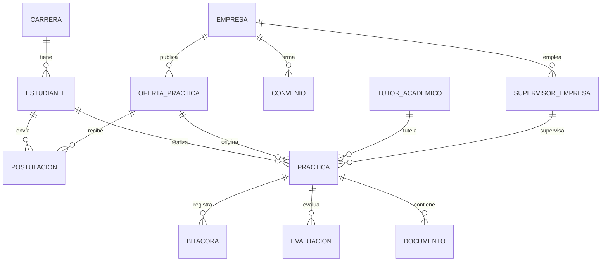

# Arquitectura funcional y relaciones

## Capas

- **Vista:** `views/*.fxml`, totalmente compatibles con edición visual de contenedores en Scene Builder y con estilos `styles/app.css`.
- **Controladores:** `PrincipalController`, `InicioController`, `CrudController`, `ReportesController`. No se escriben consultas SQL en controladores.
- **Catálogo UI:** `EntityCatalog` describe el módulo, los campos requeridos, las etiquetas y las clases Java de cada una de las 12 entidades.
- **Modelo de dominio:** `model/{academico,alianzas,asignaciones,seguimiento}/*.java` con `jakarta.persistence.Entity`, `Id`, `GeneratedValue`, `ManyToOne`, `OneToMany`, `JoinColumn` y `Enumerated`.
- **Persistencia:** `JpaUtil` inicializa el `EntityManagerFactory` con variables de entorno.
- **Repositorio:** `JpaRepository<T>` encapsula operaciones CRUD y transacciones JPA, con `rollback` ante errores.
- **Reglas de negocio:** `ValidacionDeNegocio` verifica campos obligatorios, correos, fechas, cantidades y coherencia del supervisor.
- **Servicios:** `ReporteHqlService` ejecuta cuatro consultas HQL sobre entidades relacionadas.
- **PostgreSQL:** 12 tablas creadas por `sql/01_esquema.sql`; datos de demostración por `sql/02_datos_ejemplo.sql`.

## Relaciones relevantes

**Nota sobre el cardinal:** las colecciones @OneToMany son el lado inverso (`mappedBy`), con `FetchType.LAZY`; el lado propietario está en las entidades hijas con `@ManyToOne` y `@JoinColumn`. Para mantener la integridad, no hay `CascadeType.REMOVE`.

## Reglas

1. No se acepta fecha final menor a la inicial; se valida también en PostgreSQL.
2. Cupos y horas requeridas deben ser positivos; una bitácora registra de 1 a 24 horas.
3. Calificación numérica entre 0 y 100.
4. `estudiante + oferta` es combinación única para postulaciones y prácticas.
5. Una práctica no puede asignar supervisor ajeno a la empresa de la oferta (validación Java).
6. FKs restrictivas impiden eliminar datos referenciados.
7. Las búsquedas por pantalla son filtros en memoria sobre entidades recuperadas mediante Hibernate; el volumen de demostración es pequeño.

## Consultas HQL

La definición y ejecución están en `service/ReporteHqlService.java`, no mediante JDBC directo. Los cuatro reportes incluyen `JOIN` o `LEFT JOIN` entre asociaciones ORM.
